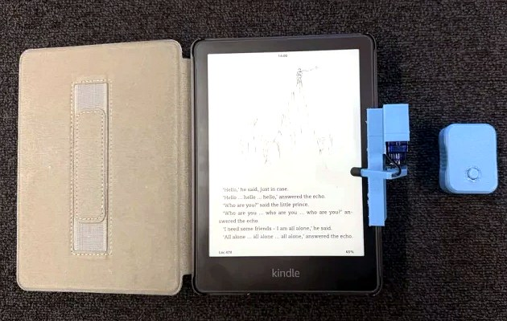
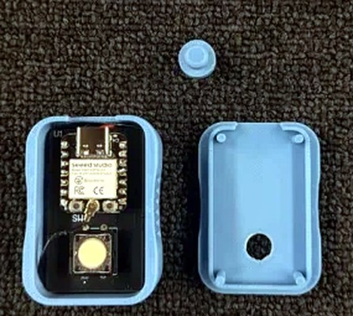
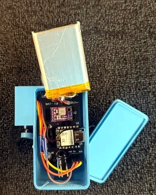
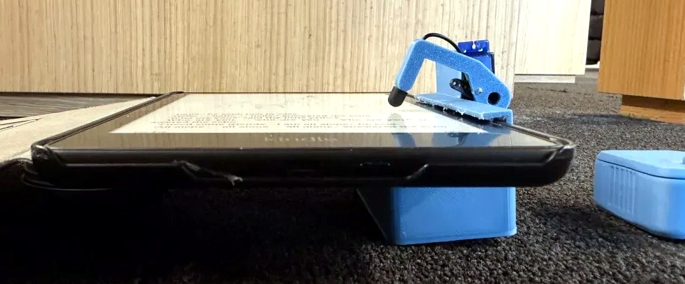
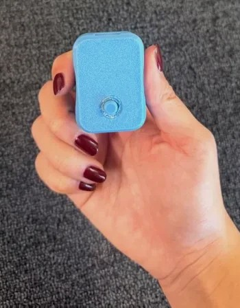

# Wireless Kindle Page Turner

Wireless page turner for a Kindle Paperwhite, built with two custom ESP32-C3 PCBs, a servo arm, and 3D-printed enclosures.

  

## Demo

https://github.com/user-attachments/assets/5dd0aaf3-1f02-4f95-8dad-e84fb184d603

Remote turns pages on a Kindle Paperwhite!

## Overview

The system has two parts: a handheld remote (TX) and a unit that clips onto the side of the Kindle (RX). Pressing the button sends a Bluetooth Low Energy command to the RX, which swings a servo arm down to tap the screen. The stylus tip on the arm is wired to ground so the touchscreen registers the tap.

## Hardware

The TX remote is built around:

- Seeed Studio XIAO ESP32-C3
- Omron B3F-4000 push button
- 400 mAh LiPo, charged over USB-C

The RX unit is built around:

- Seeed Studio XIAO ESP32-C3
- Adafruit MiniBoost 5V 1A to power the servo, enabled from D3
- 1200 mAh LiPo with a KCD11 power switch
- TowerPro SG92R micro servo
- 1000 µF capacitor on the 5 V rail to handle the servo's current spikes

  
  &nbsp;&nbsp;
  

## PCB Design

I designed both boards in Altium Designer. They are two-layer boards with ground pours and a few custom footprints.

| Board | Schematic | Altium project | Gerbers | BOM |
|---|---|---|---|---|
| TX | [`tx_schematic.pdf`](hardware/pcb/tx/tx_schematic.pdf) | [`tx/altium/`](hardware/pcb/tx/altium/) | [`tx_gerbers.zip`](hardware/pcb/tx/tx_gerbers.zip) | [`tx_bom.xlsx`](hardware/pcb/tx/tx_bom.xlsx) |
| RX | [`rx_schematic.pdf`](hardware/pcb/rx/rx_schematic.pdf) | [`rx/altium/`](hardware/pcb/rx/altium/) | [`rx_gerbers.zip`](hardware/pcb/rx/rx_gerbers.zip) | [`rx_bom.xlsx`](hardware/pcb/rx/rx_bom.xlsx) |

Libraries are in [`hardware/pcb/libraries/`](hardware/pcb/libraries/). `Kindle_Custom.PcbLib` and `SolderPad.SchLib` are custom. The XIAO library is from Seeed Studio and the MiniBoost library is from Adafruit.

## Enclosure

Both enclosures were 3D printed in PLA and print without supports.

The RX unit clips onto the right edge of the Kindle, with felt inside the clip for grip. The electronics sit in a box behind the Kindle, and the servo is mounted just outside the edge. The arm is hook-shaped so it reaches over the bezel and taps the screen.

  

The TX remote is shaped to be held in one hand, with finger grooves on the sides and a recess around the button.

  

Final print files:

- TX: [`tx_tray.stl`](hardware/enclosure/tx/tx_tray.stl), [`tx_lid.stl`](hardware/enclosure/tx/tx_lid.stl), [`tx_button.stl`](hardware/enclosure/tx/tx_button.stl)
- RX: [`rx_body.stl`](hardware/enclosure/rx/rx_body.stl), [`rx_lid.stl`](hardware/enclosure/rx/rx_lid.stl), [`rx_arm.stl`](hardware/enclosure/rx/rx_arm.stl)

The idea of a servo arm clipped to the edge of the Kindle came from [Kindle Page Turner](https://www.thingiverse.com/thing:3039314) by alexmikes on Thingiverse! The enclosures here were designed from scratch.

## Firmware

The remote spends most of its time in deep sleep. A button press wakes it up, it connects to the RX over BLE, and sends a tap command. It then stays connected for one minute so the next presses are fast, and goes back to sleep.

The RX waits for commands from the remote and moves the servo to the tap angle and back. The servo is turned off between taps so it doesn't buzz or waste power.

Final code: [`tx.ino`](firmware/tx/tx.ino), [`rx.ino`](firmware/rx/rx.ino)

## Testing

| Metric | Result | Notes |
|---|---:|---|
| Page-turn success rate | **50/50 (100%)** | Consecutive button presses |
| Button-to-tap latency | ~0.2 s / ~1.2 s | While connected / from sleep |
| Wireless range | > 35 m | |
| TX standby current | 50 µA | Deep sleep |
| TX standby life | ~8 months | Estimate, sleep only |
| RX idle current | 30 mA | Waiting for the remote |
| RX run time | ~28 hours | Estimate |

Latency was measured from slow-motion video by timing the button click and the start of the servo movement. Most of the delay on the first press comes from the remote waking up and reconnecting, which is why it stays connected for a minute afterwards. Battery life estimates assume 70% of the rated battery capacity is usable.
